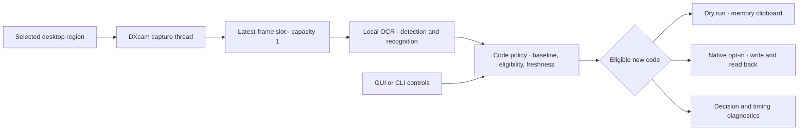
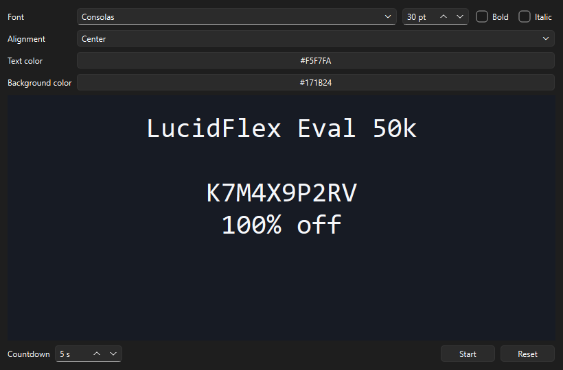

# OCR Livestream Text Detector

## Project overview

A Windows desktop application that reads short-lived promotional and redemption codes from
a selected area of a livestream. It runs OCR locally and can copy an eligible code to the
Windows clipboard for manual use. This repository documents v0.2.0.

## Motivation and problem statement

Livestream overlays may disappear before a viewer can transcribe a code, and the text is
often rendered directly into the video. The detector observes screen pixels and focuses
on the selected region so that surrounding chat, banners, and other text are less likely
to compete with the target.

## Key features

- **Live region capture.** Select a monitor and drag a region of interest (ROI) in a preview.
- **Local OCR and code identification.** Discount and Game profiles use format, context,
  OCR confidence, and source resolution. Game also supports internal hyphens. A single
  eligible observation can confirm a static reveal, preserving character case and glyphs.
- **Controlled clipboard automation.** Starts disarmed in dry-run mode. Each arm allows
  one copy. Baseline and session deduplication suppress previously seen or copied codes.
  Native mode requires opt-in and verifies the exact Unicode clipboard contents.
- **Diagnostics and testing.** Inspect OCR decisions in the GUI, collect CLI timing reports,
  replay labelled fixtures, or test on-screen reveals with the simulator. Native copy can
  trigger an optional local WAV notification.

## Technology stack

| Layer | Technology |
| --- | --- |
| Desktop and platform | Python 3.12, Windows 11, PySide6 |
| Screen capture | DXcam and Windows DXGI Desktop Duplication |
| Image processing and OCR | NumPy, OpenCV, RapidOCR with PP-OCRv6 small models on ONNX Runtime CPU |
| Clipboard and tooling | pywin32, PowerShell, pytest, Ruff, strict mypy |

## System architecture



Capture runs separately from the OCR and policy worker. The producer publishes owned
frames and skips pixel-identical regions. New frames replace pending ones while OCR is busy.
The worker recognizes text and applies the policy with a default 3-second live frame-age
limit. Stop, disarm, and capture failure can inhibit a pending write.
[Project specification](docs/PROJECT_SPEC.md)

## Installation and setup

Install 64-bit Python 3.12 on Windows 11. Run these commands in PowerShell from the
repository root. Setup creates `.venv` and installs pinned dependencies. The second
command adds the Qt dependency used by the detector GUI and simulator.

```powershell
./scripts/setup.ps1
./.venv/Scripts/python.exe -m pip install -c requirements-lock.txt PySide6==6.12.0
```

Installation needs network access. The default models ship with RapidOCR and run locally.

## How to use the application

```powershell
./.venv/Scripts/python.exe -m stream_code_capture.gui
```

1. Choose a monitor and the **Discount** or **Game** profile.
2. Select **Load preview**, then drag around the likely code area and nearby context.
3. Select **Start**, wait for **Ready**, then select **Arm**. A dry-run result appears in
   the GUI and disarms the detector.
4. For an actual clipboard write, enable **Use Windows clipboard for this session**
   before starting. Paste into a text editor to verify the result. Disarm before moving
   or covering the source, and use **Stop** to end the session.

The native GUI path is scoped to the primary DXcam output 0 at 1920 × 1080, 100% scaling,
SDR, and a local Windows console with fixed display topology.
[Windows verification and CLI instructions](docs/WINDOWS_VALIDATION.md)

## Livestream Code Simulator

The simulator reveals formatted, multiline sample text after a configurable countdown.
Hide a sample code with **Start**, point the detector at the reveal area, then arm during
the countdown. The simulator records reveal timestamps locally.

```powershell
./.venv/Scripts/python.exe scripts/livestream_code_simulator.py
```



[Simulator validation](docs/SIMULATOR_VALIDATION.md)

## Performance and testing results

| Test | v0.2.0 result |
| --- | --- |
| Paired offline replay using generated inputs, simulator renders, and labelled game stills | Exact copies rose from 52 to 78 of 111 positive cases. The revised policy copied 15 wrong transcriptions and wrote in 3 of 37 negative cases. |
| Offline replay latency on the 52 cases copied exactly by both versions | Median first input to memory write fell from 278 ms to 134 ms. |
| Static simulator renders, offline OCR | 7 of 8 positive cases copied exactly, up from 0 of 8. |
| Real Windows DXcam capture of generated scenes, memory clipboard | Both versions copied 3 of 3 exactly. Median first captured frame to memory write fell from 1,406 ms to 213 ms. |
| Native Windows clipboard | The operator manually tested v0.2.0 and reported a pass. This is a separate functional check. |

Run `./scripts/check.ps1 -Ocr` for dependency checks, Ruff, strict mypy, and the full
pytest suite with local OCR. The release check passed **244 tests with 3 expected
tiny-text failures**. [Benchmark methods and results](docs/DETECTION_POLICY_VALIDATION.md) ·
[Operator clipboard result](docs/WINDOWS_VALIDATION.md#v020-operator-clipboard-test)

## Technical challenges and solutions

- **Capture faster than inference.** A single pending frame bounds the backlog. Profiling
  measures capture, handoff, detection, recognition, policy, and clipboard separately.
- **Repeated OCR work in large regions.** The CPU baseline can reuse recognition batches
  when every crop and the batch grouping match exactly. Code-shaped text stays on the
  fresh recognition path. [ROI profiling](docs/ARMED_ROI_VALIDATION.md)
- **Distractors and stale output.** The policy applies code-shape and context checks,
  suppresses baseline and copied values, and rechecks freshness at clipboard handoff.
  Deterministic tests cover cancellation, deduplication, and readback alongside real OCR tests.

## Known limitations

- OCR can confuse similar characters even at high confidence. Thirteen of the 15 wrong
  positive copies in the offline comparison changed an O to zero. Tiny or compressed text
  can fall below the source-resolution floor, and ordinary code-shaped text can qualify.
- Dense or changing regions can exceed the freshness limit. Representative livestream
  accuracy, broader display configurations, and sub-100 ms performance remain unqualified.
- Capture follows a fixed screen region. Covering a source window can change the pixels the
  detector sees. [Windows validation scope](docs/WINDOWS_VALIDATION.md)

[Validation index and earlier development records](docs/VALIDATION.md)
