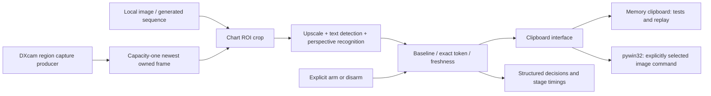

# Instant Stream Code Capture — project specification

Status: v0.2.0, Windows 11 x64, Python 3.12. The detector prioritizes the first exact copy from a
reliable observation. Discount and Game share one policy, with optional hyphens and
game redemption/expiry phrases in Game. The OCR model, display scope and GUI controls
carry forward from the previous build. The revised policy recovers more exact codes
and can also copy incorrect OCR readings. See [detection policy validation](DETECTION_POLICY_VALIDATION.md).

The operator signed off G2 for limited personal use on 2026-11-05 MYT after 30 exact
manual native paste matches. Phase 6 added explicit per-session GUI native-copy opt-in
and followed with GUI paste smoke checks. The operator also reported a PASS for native
Windows clipboard copying on the v0.2.0 build. Broader G2/G3/G4 qualification remains open.
See [Windows validation](WINDOWS_VALIDATION.md) and [Phase 6 validation](PHASE6_VALIDATION.md).

Phase 2 documents previous O/0 errors, CPU model experiments, and last-frame-age
instrumentation. Its blanket ambiguity abstention is historical. The three strict
challenge xfails and 10 px/character guard remain. Phase 3 added exact labels,
source/session-disjoint splits, and raw-recognition versus policy scoring. Independent
real-video qualification requires permitted media and independent transcription.
[Phase 2 evidence](PHASE2_VALIDATION.md) · [Dataset workflow](DATASET_WORKFLOW.md)

## User outcome and requirements

A streamer briefly displays a one-use promotional code within a video. The user watches
the stream on the Windows PC; pixels from a phone screenshot are only a visual reference.
The desired example is tiny, slightly slanted chart text above product/discount text.
A large permanent `40% OFF — USE CODE: JORDY` banner, live chat, and chart prices are
distractors. The implementation must find *new chart codes*, not the first uppercase word.
Example strings are not runtime allowlists or denylists.

1. Select a chart-area ROI in physical source-image pixels. Exclude the top banner and chat.
   Detect text positions automatically inside that ROI; no absolute target-code coordinates.
2. Recognize pixels locally using warmed RapidOCR/ONNX models. Upscale small text, use
   detector quadrilaterals and RapidOCR's perspective crop for recognition of slanted lines.
3. Extract an exact ASCII token of 6–24 characters with letters and digits, preserving
   case, O and 0. Game also permits internal hyphens. Explicit labels and nearby
   promotional text support shorter or more word-like formats. Strong standalone codes
   can qualify without adjacent text.
4. Start disarmed and collect a baseline before arming. A single fresh observation with
   one eligible new code can confirm. Reject stale or unordered frames. Exact matches to
   tokens collected while disarmed or successfully copied earlier are ineligible.
5. Copy once per explicit arm. Remember copied strings for the process lifetime, including
   across rearm. Do not retry a failed clipboard write without rearming. Report failures.
6. Consume the newest available captured frame, with at most one pending frame and one
   inference in flight. Drop obsolete pending frames; never accumulate an OCR queue.
7. Do not redeem, click, submit, bypass DRM, scrape DOM, send frames remotely, or phone home.
8. Provide image CLI, deterministic generated fixtures and ground truth, headless unit
   tests, real offline OCR integration, and repeatable benchmark inputs before GUI work.
9. Eventually validate real DXcam frames -> this recognizer/policy -> Windows clipboard.
   File replay and mock clipboard tests cannot satisfy the live gate.

## Architecture

| Component | Contract / ownership |
|---|---|
| `Frame` | Owned uint8 BGR image, increasing sequence, monotonic acquisition timestamp |
| `Rect` | Exclusive right/bottom, validated in frame coordinates; crop copies memory |
| `Recognizer` | `warmup()` and `recognize(image) -> list[TextLine]`; boxes ROI-relative |
| `RapidRecognizer` | One reusable engine; local pinned models; fails on missing requested provider |
| `TextLine` | Exact text, OCR confidence, axis-aligned envelope of detector quadrilateral |
| `DecisionPolicy` | Single-thread owner; baseline, arm, observe, committed, disarm |
| `Pipeline` | Crop -> OCR -> decision -> clipboard; no async inference queue |
| `Clipboard` | `write(text)` returns on success, raises on failure; memory or pywin32 |
| `LatestFrame` | Lock-protected capacity-one pending slot, replaces oldest, counts drops |
| `synthetic` | Seeded renderer, ground-truth manifest, separate from recognition |
| `CaptureWorker` / `DxcamSource` | DXGI polling, owned BGR frames, duplicate ROI suppression, capacity-one handoff |
| `LiveSession` / `Controls` | Console lifecycle; single-owner policy; urgent stop/disarm write inhibition |
| `Metrics` | Bounded last-10000 samples per stage, p50/p95/max and sample counts |
| CLI | Generate, image, replay, live; JSON stdout; memory clipboard and disarmed by default |

ROI must remain fixed for a policy session. Construct a new session after resizing the
source or changing ROI; do not carry candidate coordinates or baseline across unrelated
scenes. Console commands are marshalled to the policy owner. An inhibition event/generation
and a lock around the native write linearize stop/disarm against in-flight inference.
The live producer owns its DXGI resources; policy/OCR has a single separate owner.

The pinned DXcam `grab(copy=True, new_frame_only=True)` API is polled by our producer
instead of using DXcam's blocking buffered reader. DXGI calls are nonblocking in 0.3.0.
Acquisition-call start and completion use `perf_counter_ns`; there is no inferred conversion
from DXGI presentation timestamps. Identical ROI pixels are dropped even if the desktop
changed elsewhere. Our handoff has one pending frame and no inference queue. Any DXcam
warning invalidates the session. A blank image or 2500 ms without a completed capture poll
also stops capture. Successful polls with no update or identical ROI pixels keep the session
alive without publishing an OCR observation. Live baseline readiness may use a valid
recognized frame followed by at least the configured baseline interval of healthy,
unchanged capture polls. Any newer pending changed frame must be processed first.
Idle stability never supplies an armed observation. Moving baseline readiness uses
two recognized frames spanning at least 500 ms. Accepted code sets can differ.
Reads over 2500 ms can add suppression while capture remains healthy, and can
establish readiness only if healthy polls show the same image is still current.
Live sessions ignore pending frames acquired before arm. Armed result freshness is
checked before inference, after inference and at the locked clipboard handoff.
Camera initialization has a separate bounded 10-second allowance and is reported separately.
Window identity/occlusion and fast content changes are not fully detected; see manual matrix.

## Decisions and temporal semantics

On large baseline CPU inputs, OCR runs text detection across the entire current ROI.
It can reuse a previous recognition batch only when every crop's shape, pixels and
batch grouping match exactly and the batch contained no code-shaped text in either
profile. Code-shaped reads always run on the current frame. Reuse is bounded and the
original frame timestamp still governs freshness. See [armed ROI validation](ARMED_ROI_VALIDATION.md).

Both profiles accept a whole token or one attached to an anchored label such as
`Code:`, `Coupon code:`, or `Use code`. Tokens contain both an ASCII letter and a
digit and span 6–24 characters. Game also allows internal hyphens. An attached label
can support a code by itself. Separate trusted headings or offers can support a
nearby code above, below, or beside them. A standalone token needs at least eight
characters, at least two digits, and a digit between letters. An ordinary handle
or identifier that happens to match a code format can still be accepted.

The code OCR floor is 0.96, and separate supporting text must score at least 0.75.
The detector's top-edge pitch floor remains 10 original pixels per character and
applies to both profiles. Upsampling cannot increase source pitch. OCR quality
rejections veto eligibility. Tiny compressed inputs still fail the three strict
expected-failure recall tests. The OCR score provides no calibrated estimate of
exactness. Case and recognized characters are preserved throughout.

Baseline suppression is exact and monotonic within a session. Code-shaped text
seen while disarmed remains ineligible even if the surrounding context changes.
Unobserved or misread baseline text can escape suppression. Identical tokens at
several positions count once. Several different eligible new tokens cause abstention.

The live default frame-age budget is 3000 ms, measured from capture acquisition
start through the clipboard handoff. A stop, disarm, capture failure or expired
deadline inhibits a pending result. Native success requires exact Unicode clipboard
readback, then disarms and records the string for deduplication. A clipboard failure
also disarms. The offline replay budget remains 10000 ms for accuracy testing.

## Timing definitions and instrumentation

Use `perf_counter_ns()` on one host. Record first eligible captured-frame acquisition
`t0`, capture completion, inference start/end, policy end, clipboard API success and close
`t_clip`. **Primary latency = t_clip - t0**, including dropped frames and confirmation
delay, not just the last accepted frame's processing time. If the first visible frame is
dropped, retain its timestamp in a capture-side validation trace. Do not substitute the
first OCR detection time. Physical video presentation latency is a separate metric.

| Stage | Definition | Initial budget hypothesis |
|---|---|---:|
| Capture/transfer | PC frame availability to owned ROI pixels | 8 ms |
| Handoff + crop/preprocess | Capture timestamp to inference-ready image | 4 ms |
| First OCR | Detection, perspective crop and recognition | 32 ms |
| Decision | Format, evidence, freshness and dedup checks | 1 ms |
| Clipboard | Open, write, verify Unicode readback, and close | 5 ms |
| Reserve | Scheduling and jitter | 10 ms |

Stage budgets are historical engineering hypotheses with the former 40 ms second-frame
wait removed. Startup and model warmup are measured separately. Phase-1 reports
capture-call duration, crop, preprocessing, OCR, detection/recognition substage times when
available, policy, clipboard, process, handoff age and per-frame result time. Live reports
include p50/p95/max and sample counts, bounded to the last 10000 samples per metric. Generic
`first_observed_to_clipboard` is a lower bound that excludes earlier dropped/rejected code
frames. Only the controlled screen-test marker records the true first captured code frame
before handoff drops, independent of OCR, and yields the primary latency measurement.
Startup/warmup is excluded. Add deadline misses, CPU/GPU load and memory for G3. Record
ROI size, display scale/Hz,
video resolution/FPS/bitrate, model hashes, package versions and target PC hardware.

## Dependencies and model provisioning

Versions/API checked on 2026-10-29 against PyPI and installed source (see validation).
Use `rapidocr`, not the legacy `rapidocr_onnxruntime` API. It returns an object with
`boxes`, `txts`, `scores`; no-text results contain `None`. The current wheel bundles
PP-OCRv6 small detection and recognition models and embedded recognition dictionary.
Explicit local paths and dictionary preflight prevent fallback downloads. Network-blocked
integration tests exercise initialization, warmup and recognition.

Use only `opencv-python-headless`: RapidOCR depends on it, and installing another OpenCV
wheel beside it creates a shared `cv2` conflict. PySide6 owns UI display.
Core/dev/Windows direct dependencies are exact-pinned; `requirements-lock.txt` freezes the
tested Windows transitive resolution. The optional GUI dependency is pinned.
Setup may access PyPI; recognition takes local files/arrays only.

CPU is validated first. Adapter flags `--provider cpu|cuda|directml`, `--threads`, `--scale`
allow identical replay benchmarks. GPU runtime packages must be installed in a **separate**
environment with only one ONNX Runtime distribution; GPU wheels/drivers are not part of the
validated CPU lock. Check provider availability and actual detector/recognizer sessions;
fail instead of silently benchmarking CPU fallback. Compare accuracy as well as timings.

## Assumptions and risks

| Risk / assumption | Impact | Mitigation and release evidence |
|---|---|---|
| Text too small/compressed/occluded | Wrong or missed exact code | Challenge corpus, abstain, scale/ROI tuning, held-out real clips |
| Perspective and slope | OCR loss | Detector quadrilateral crop; test +/-6 degrees and beyond |
| Moving candles overlap text | False movement localization | Do not treat all pixel change as new text; use text/content tracking later |
| Banner/chat accidentally in ROI | Wrong copy | User ROI preview; baseline and context; full-scene distractor tests |
| Baseline OCR misses permanent code | New-code false positive | Sample while disarmed, suppress observed tokens, and run negative soaks |
| Code present before arming | Miss by design | Explicit readiness/status, user knows baseline behavior |
| OCR misreads a glyph at high confidence | Wrong exact code | Preserve the reading, report errors and measure against exact held-out labels |
| Current v6 small CPU cost | >100 ms latency | Measure; smaller detector/recognizer, recognition crops, providers next |
| Repeated capture of static pixels | Redundant OCR | Suppress identical ROI frames and confirm from the first eligible result |
| Capture access loss / minimized / protected video | Black/stale frame | Disarm, show unavailable, no DRM workaround |
| DPI/multi-monitor/rotation/HDR | Wrong ROI/colors | Physical-pixel ROI, DPI awareness and live matrix testing |
| Clipboard locked or later changed by another app | Failed/lost copy | Immediate failure/disarm; manual verification; no overwrite retry loop |
| EmptyClipboard succeeds then Set fails | Previous clipboard may be lost | Report failure; do not promise atomic preservation |
| Baseline/copy set grows | Memory over very long session | Explicit session lifecycle; bounded retention design if needed |
| Synthetic fixtures differ from stream | Overstated accuracy | Separate smoke from real held-out corpus; never train/tune on holdout |
| Repeated runs differ across hardware | Threshold instability | Pin models; record hashes/providers; allow no fuzzy exact-code scoring |

## Phased roadmap and pass/fail gates

**G1 — Foundation (established).** Pass iff installation resolves with `pip check`; Ruff
lint/format and strict mypy pass; all headless unit tests pass; network-blocked real OCR
integration recognizes all three seeded standard chart targets exactly and writes each
once to memory, with zero writes for the negative-only sequence and zero JORDY writes.
Generator must vary codes by seed and refuse to overwrite fixtures. Fail on any assertion,
network attempt, incorrect copy or unreported skipped integration check. This is a smoke
gate only. Challenge failures are recorded, not mislabeled as passed accuracy.

**G2 — Real Windows path (implemented; full qualification pending).** Require DXcam region capture into latest-frame handoff,
owned BGR copies and timestamps, explicit arm/disarm/stop, disarmed baseline readiness,
source-loss disarming, and structured latency tracing. On target PC, a local test video
rendering generated scenes must feed *real captured frames* into this exact pipeline and
the real clipboard. Pass iff 30 randomly positioned/code-varied events produce exact
manual paste matches, no duplicate or disarmed writes, no banner/chat writes in a 30-minute
negative run, capture loss disarms, busy clipboard failure is reported, and backlog is <=1
pending frame under deliberately slow OCR. Log evidence. No live gate passes by file replay.

**G2 source scope.** The source is a fixed rectangle of desktop pixels on a selected
monitor. Covering, moving, or minimizing a window can change the pixels in a healthy
capture. A covering window can display a code that meets the confirmation rules and
is copied in native mode. Users must disarm before moving, covering, or minimizing
the intended content. Before enabling GUI native clipboard mode, require full G2
qualification, a clear warning about this risk, and explicit user opt-in.

Monitor loss, invalid capture, DXcam access loss, capture errors, and capture-poll watchdog
expiry must stop the session and disarm. Restart requires a fresh baseline and explicit
rearm. Healthy idle polls preserve session state, and identical pixels supply no new
observations. Freshness, duplicate suppression, and all other
G2 checks remain mandatory. The historical moving-occlusion failure remains in the
manual ledger under its original criterion.

**Approved personal-use G2 scope (2026-11-05 MYT).** Initial GUI native copying is
limited to the center primary monitor at 1920 × 1080, 100% scaling, SDR, on the local
Windows console, with monitor topology unchanged during a session. Re-enumerate outputs
and select a fresh ROI after configuration changes. Secondary-monitor native use, HDR,
rotation, 150%/200%, remote sessions, and live display/topology changes remain unqualified.
Existing secondary-monitor observations remain valid within their recorded scope.
For this initial personal-use G2 sign-off, the user explicitly accepts the real
lock/unlock access-loss pass together with injected monitor-loss/blank-frame tests
and native recovery probes in place of physical unplug/replug. Physical hotplug
remains deferred and unverified. The display-matrix requirements apply to any future
expansion of supported configurations. All capture invalidation and clipboard safety
protections above remain mandatory even during unexpected unsupported transitions.
The GUI must enforce this supported scope when native mode is implemented. The 30
manual matches and remaining control/recovery observations still require recorded
evidence and final sign-off. The operator confirmed G2 sign-off for this limited scope
on 2026-11-05 MYT. Native GUI integration requires explicit opt-in, the warning and
scope enforcement above, and separate integration validation. G3/G4 remain pending.

**G3 — Accuracy and latency.** Freeze a held-out corpus of >=1000 distinct code appearances
and >=10000 negative chart/chat/banner scenes from permitted real or representative PC
video, with independent transcription, 10–24 px text heights, slopes, compression, and
durations of 100/250/500/1000 ms. Require zero incorrect accepted strings, >=99% event
recall for declared supported conditions, zero negative-scene writes, and zero repeats.
Report excluded/unsupported conditions and confidence intervals; 0 errors is not proof
of perfect future accuracy. On target PC, 100 warmup events followed by >=1000 measured
events: p95 primary latency <100 ms, p99 <150 ms, and deadline miss rate at 100 ms <=5%,
with the same accuracy thresholds, capacity-one backlog and no monotonic memory growth
>50 MB over a 30-minute soak. Report worst case; do not claim every event is <100 ms.
CPU and any chosen GPU configuration must each pass accuracy; choose the fastest proven
configuration. Failure blocks performance claims and product readiness.

**G4 — Minimal desktop UX.** For qualification after G2, require PySide6 ROI selection, arm/disarm and obvious
state, start/stop, timing/provider diagnostics, and session reset. Pass smoke tests at
100/125/150/200% DPI, two monitors, source resize, lock/unlock, and shutdown during inference;
zero unintended clipboard writes. GUI cannot block capture or inference. G3 still gates
performance/accuracy claims. Packaging and broader capture are later work.

## Manual Windows validation

Phase 5 adds native write/readback timing and explicit failure/negative qualification
harnesses; see `PHASE5_VALIDATION.md`. Frame freshness is checked after controls and again
at the locked clipboard handoff. Native completion-age violations are reported as failures;
the Windows API is not a hard-real-time service. Neither this fix nor successful generated
screen tests relax the G2 manual/display checks or the G3 representative accuracy gate.

Phase 5.1 isolates arena allocation retention with otherwise identical session settings.
The arena-disabled 1800-second negative soak passes the unchanged harness memory gate
(14.1 MiB growth versus 50 MiB), compared with Phase 5's arena-on 77.8 MiB failure.
Native paired measurements expose a latency/memory tradeoff; see `PHASE51_VALIDATION.md`
for all completed comparisons, failures and recovery checks. No runtime default, model,
recognition rule or acceptance threshold is changed. A fixture memory pass does not satisfy
the independent accuracy, manual Windows or latency gates above.

See `docs/WINDOWS_VALIDATION.md` for current image-to-clipboard diagnostics and the explicit
remaining G2 qualification procedure. Do not call a phone screenshot or file replay live capture.
